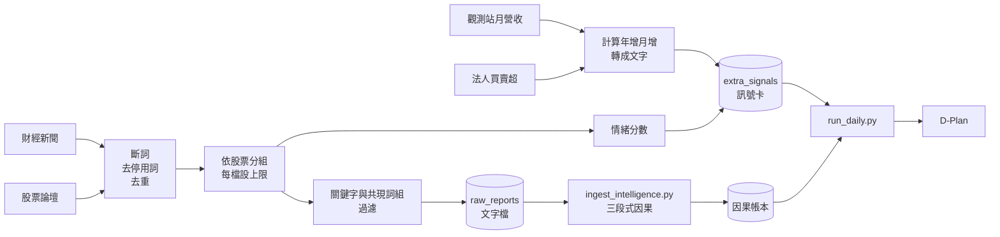

# 用 Lab 1 的方法擴充情報來源：對應報告

> 撰寫：月詩（陳熙緁）　日期：2026-11-03
> 依據：Lab 1 Master 題目與 Homework（Reddit 股票情緒資料集）、專案 `b7562c4` 版本的程式碼

## 一、這份報告要回答什麼

隊長希望把更多外部資料接進 Agent 的思考鏈。這份報告整理三件事：

1. 系統現在有哪些入口可以接資料，各自吃什麼格式。
2. Lab 1 學過的每個資料探勘步驟，放到台股情報上要怎麼用。
3. 建議先接哪幾個資料源，以及怎麼包成短、中、長三層。

在這之前，有三個現有入口的問題要先修，不然接再多資料也會被吃錯或吃不到（見第三節）。

## 二、系統現在的兩個資料入口

| 入口 | 放什麼 | 誰讀它 | 進到哪裡 |
|---|---|---|---|
| `inputs/extra_signals/*.json` | 結構化訊號卡，一檔股票一張 | `run_daily.py` → `collectors.load_extra_signals()` | 漏斗加分、D-Plan 的 observations（O 編號）、個股履歷 |
| `inputs/raw_reports/*.txt` | 法說會、新聞等長文字 | 手動執行 `scripts/ingest_intelligence.py` | 關鍵字過濾 → LLM 提煉三段式因果 → `runs/<日期>/dossier_ledger.json` 與 `impact_ledger.json` |

訊號卡的欄位（`collectors.py` 實際讀取的）：

| 欄位 | 說明 |
|---|---|
| `ticker` | 必填，必須在 150 檔白名單內，否則整張卡被丟掉 |
| `statement`（或 `summary`、`headline`） | 事實陳述，會原文寫進 D-Plan |
| `values`（或 `metrics`） | 數值，Python 鎖定，不讓 LLM 改 |
| `polarity` | **只認 `"positive"`**，其他任何值都當成利空扣分（見第三節） |
| `topic`（或 `category`） | 主題，例如 `fundamental` |
| `authority`、`url`、`content_as_of` | 來源機構、可查證網址、資料時間，會寫進 D-Plan 的 sources |
| `linked_target_ticker` | 選填，指定 A→B 的傳導關係 |

## 三、接資料前要先修的三個問題

### 1. 範例資料被當成真實資料餵給 AI（最急）

有兩個地方在用沒有查證過的數字，而且標的來源都是官方機構：

**(a) 月營收與三大法人的訊號程式沒有真的抓資料。** `graph.py` 每天都會執行 `signals/revenue.py` 和 `signals/institutional.py`。這兩支在沒有給資料檔時（目前就是沒給），會改用寫在程式裡的「示範種子」：

| 程式 | 寫死的內容（節錄） | 標示的來源 |
|---|---|---|
| `revenue.py` | 台積電單月營收年增 +39.6%、弘塑 +52.8%、奇鋐 +41.2%、中華電 +1.5% | 公開資訊觀測站，時間標成交易日當天 18:00 |
| `institutional.py` | 外資連 3 買台積電逾 3.5 萬張、投信外資合力買超弘塑逾千張等 | 證交所 |

這些卡會進到 PM Agent 的提示詞（每檔股票後面的「法人買超 X 張」「營收年增 X%」標籤），也會被 JAB 評級寫進因果連線帳本。換句話說，AI 每天看到的籌碼與營收訊號都是同一組固定數字。

另外，時間標成「交易日當天 18:00」，比繳交時間（交易日早上 08:55 前）還晚，等於引用了未來的資料。

**(b) 範例檔放在正式的投餵資料夾。** `inputs/extra_signals/sample_earnings_reports.json` 是 11/03 跟著新版一起進 repo 的範例，內容跟 (a) 類似（台積電年增 39.6%、廣達 AI 伺服器佔比 52%、台燿稼動率 92%）。`run_daily.py` 每天都讀這個資料夾，所以 11/04 試跑的 D-Plan 把這三筆寫成正式的觀察 O38～O40，來源寫公開資訊觀測站、時間 10/31。

> **已修正（37a50a8）**：範例檔已移到 `docs/examples/`，`load_extra_signals()` 也會略過檔名含 `sample`、`example`、`test`、`dummy`、`mock` 的檔案。要注意這是子字串比對，`latest_revenue.json`、`contest_*.json` 這類檔名也會被跳過，之後放真實訊號卡時檔名要避開這幾個字。

11/04 試跑時，AI 提議加碼台積電的理由是「營收 YoY 高達 +39.6%，法人大舉買超」，正好就是這兩組資料。

抽檢時對不上觀測站與證交所的實際資料，就可能被認定資料不實。建議：

- ~~範例檔移到 `docs/` 或改名成 `.json.bak`。~~（已完成）
- 兩支訊號程式在沒有真實資料時回傳空清單，不要用示範種子。
- 之後改成真的去抓（見第五節）。

### 2. `polarity` 只認 `"positive"`

`funnel.py` 的判斷是：

```python
delta = 2.0 if sig.polarity == "positive" else -2.0
```

所以寫 `"neutral"`、`"bullish"`、或沒寫都不對：

- 沒寫的話，`collectors.py` 預設成 `"positive"`，範例檔三筆移走前就是這樣每天被加分。
- 寫 `"neutral"` 或 `"bullish"`（`signals/base.py` 的註解用的是這組詞）會被當成利空扣 2 分。

建議：統一成 `positive / negative / neutral` 三個值，`neutral` 不加不減。在修好之前，我們產的卡一律明寫 `positive` 或 `negative`，不寫 `neutral`。

### 3. 情報匯入的日期寫死，而且失敗時會編造因果鏈

- `ingest_intelligence.py` 的 `--date` 預設是 `2026-10-30`。`run_daily.py` 讀因果帳本時，只挑「比交易日早的最新一天」的資料夾。10/30 之後每天都有新資料夾，所以用預設日期匯入的情報會被蓋過，等於沒被讀到。執行時要指定 `--date` 為前一個交易日。
- `intelligence_agent.py` 在 LLM 失敗時有保底邏輯：原文找不到股票時，預設寫入一條「台積電 → 台燿，影響 +2.5%」的因果鏈，三段文字也是固定句子。這等於在帳本裡放了沒有來源的因果關係。建議改成：LLM 失敗就不寫入，並印出錯誤。

## 四、Lab 1 的方法怎麼用在台股情報

我在 Lab 1 Homework 用 Reddit 股票情緒資料（847 篇，負面 315、中性 423、正面 109）跑過同一套工具，有幾個結論可以直接沿用：

- 保留停用詞時，詞頻前 20 名全是停用詞，看不出任何股票相關的東西。
- 正面類別特別少，整體詞頻幾乎只反映中性與負面貼文的用語。
- 要得到有意義的結果，得先去停用詞、改用 TF-IDF，或分類別各自計算詞頻。

下表是 Lab 1 各步驟對應到情報處理的做法：

| Lab 1 步驟 | 在 Lab 1 學到的 | 用在台股情報 |
|---|---|---|
| 篩選類別（Q1） | 只看單一類別，樣式才不會被稀釋 | 新聞先依「提到哪幾檔 150 檔股票」分組，每檔各自處理；跟 150 檔無關的直接丟掉 |
| 缺值處理（Q2） | 標籤缺了不要直接刪，用對照關係補回來 | 新聞常只寫公司名不寫代號，用「名稱 → 代號」對照表補上（`universe.py` 已有 150 檔名稱） |
| 重複資料 | `drop_duplicates` | 同一則新聞會被多家媒體轉載，依標題相似度去重，避免同一件事被算成多個利多 |
| 抽樣風險（Q3） | 不平衡資料隨機抽樣，小類別會不見 | 台積電的新聞量遠多於其他持股。每檔設上限（例如每天最多 5 則），冷門持股才不會被淹沒 |
| 詞頻矩陣與停用詞（Q4） | 停用詞會佔滿高頻詞 | 中文要先斷詞（`CountVectorizer` 預設不會切中文，需要 jieba 或字元 n-gram），再去掉「今日、表示、指出、公司」這類每篇都有的詞 |
| 變異數篩選（Q5） | 幾乎不變的詞沒有區辨力 | 篩掉只出現一兩次的錯字與罕見詞，也篩掉每篇都出現的詞，留下真正能區分事件的詞 |
| 相關性篩選（Q6） | Pearson 看線性，Spearman 看單調 | 計算「某詞出現次數」與「隔日漲跌」的相關。新聞偶爾會有極端值（同一詞重複十幾次），用 Spearman 比較穩 |
| 頻繁樣式（Q7） | 找常一起出現的詞組 | 找出「CoWoS＋擴產」「水冷＋伺服器」這類共現詞組，當作 `intelligence_filter.py` 關鍵字庫的候選，取代現在手寫的清單 |
| 降維（Q8、Q9） | PCA 看不出群，UMAP 比較清楚 | 把新聞向量用 UMAP 畫成散點圖，檢查同產業的新聞有沒有聚在一起；這主要用在進度報告的圖，不進每日流程 |
| One-hot（Q10） | 類別不能用 0、1、2、3 代表大小 | 產業別、事件類型（營收、法說、擴產、下修）轉成 one-hot，才能跟數值特徵一起算相關 |

目前的 `intelligence_filter.py` 註解寫「參考作業一文本前置過濾原理」，但關鍵字庫是人工列的 30 多個詞。上表的頻繁樣式與相關性篩選，可以讓這份清單改成從資料算出來，也比較好在報告裡說明依據。

## 五、建議先接的資料源

依「資料可公開查證、每天會更新、跟 150 檔直接相關」排序：

| 優先 | 資料源 | 入口 | 處理重點 |
|---|---|---|---|
| 1 | 公開資訊觀測站月營收 | `signals/revenue.py` | 程式架構已經有了，缺的是真的去抓資料。每月 10 日前公布，數字可直接查證 |
| 2 | 證交所、櫃買中心三大法人買賣超 | `signals/institutional.py` | 同上，架構已有、資料是假的。每天盤後更新，證交所與櫃買中心都有公開資料 |
| 3 | 財經新聞標題與內文（鉅亨網、經濟日報） | `raw_reports` | 用第四節的流程過濾，再交給 `ingest_intelligence.py` 提煉因果 |
| 4 | PTT 股票版、Dcard 理財版 | `extra_signals` | 對應 Lab 1 Homework 的 Reddit 情緒分析，算每檔的散戶情緒分數。雜訊多，排在最後 |

新聞與論壇要留意網站的使用條款與爬取頻率，能用官方 RSS 或公開 API 的就不要硬爬。

## 六、三層包裝的範例

`PHILOSOPHY.md` 要求數值不要原封不動餵給 AI，要轉成文字。以月營收為例：

| 層 | 內容 | 放在哪裡 |
|---|---|---|
| 短 | 「台燿 10 月營收年增 X%，連續三個月成長」 | 訊號卡的 `statement` 開頭一句 |
| 中 | 營收金額、年增、月增、累計年增，以及跟前三個月的比較 | `statement` 其餘部分，數值放 `values` |
| 長 | 觀測站原始公告網址與公告日期 | `url`、`content_as_of`，AI 需要時再查 |

對應的訊號卡長這樣（數字是格式示意，不是真實資料）：

```json
{
  "ticker": "6274",
  "topic": "fundamental",
  "authority": "mops",
  "url": "<觀測站公告實際網址>",
  "content_as_of": "<公告時間，必須早於交易日前一晚>",
  "statement": "<短>。<中>",
  "values": {"revenue_yoy_pct": 0.0, "revenue_mom_pct": 0.0},
  "polarity": "positive"
}
```

`content_as_of` 一定要是真實的公告時間，而且早於交易日的前一晚；`polarity` 由程式依規則判定（例如年增大於 0 為 `positive`），不要人工挑。比賽規定交易決策不能由人介入，資料蒐集與判定都要是程式自動跑的。

## 七、整體流程



## 八、建議的進行順序

1. 先修第三節的三個問題，尤其是停用示範種子（範例檔已移走）。
2. 把月營收與三大法人換成真實資料（架構已有，只缺抓取，最快見效）。
3. 把 Lab 1 的斷詞、去停用詞、去重流程改寫成中文版，接新聞進 `raw_reports`。
4. 用頻繁樣式與相關性篩選重新產生關鍵字庫，跟現在手寫的清單比較。
5. 第 3、4 步的過程與圖表，可以直接當 11/19 第二次進度報告的「資料觀察與前處理」內容。
